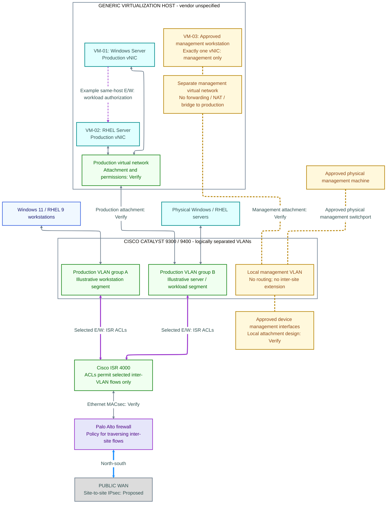

# Site-local VLAN and virtualization design

This view illustrates the logical design pattern for each site. VLAN IDs, subnet assignments, exact virtual-network attachments and the traffic matrix are not yet specified.

## Site-local logical topology

This pattern applies independently at Site A and Site B. Production groups A and B illustrate segmentation roles; their names, number and mapping to actual VLANs are not approved inventory. The Catalyst group shows VLAN separation within the switching fabric. The virtual-host group shows a common host boundary, with separate production and management attachments that require isolation verification.

**Legend:** Blue nodes are workstations; teal nodes are server workloads; green nodes are network infrastructure or logical production segments; purple nodes are firewalls; amber nodes are management-only resources; gray is the external WAN. Gray lines show attachment or transit connectivity. Purple solid lines show the selected inter-VLAN east-west path through ISR policy; the purple dashed arrow shows an example logical same-host session. Blue lines show north-south site-boundary traffic. Amber dashed lines show local management attachment, with no routing implied. Node colors describe roles, not trust or validation.

**Interpretation:** Read workstation-to-server inter-VLAN traffic through the ISR, with ACLs defining permitted reachability and workload controls defining resource access. Same-host VM traffic can remain on the production virtual network; same-VLAN traffic can also remain local. These paths need appropriate virtual-network, host and application enforcement and do not necessarily traverse the ISR or Palo Alto. The example session arrow shows a possible initiation direction, not an approved allow rule.

The management VLAN has no routed path into production, the ISR/firewall transit path or the WAN. The two virtual networks share a host boundary; their separation must be enforced and tested. No dedicated physical host NIC count, hypervisor product or detailed uplink design is implied. No logical association or common enclosure proves isolation.

Encryption labels identify mechanisms and status, not completed deployment. MACsec compatibility must be assessed for every physical Ethernet attachment, including Catalyst-to-ISR links represented by logical routing edges here. Virtual vNIC lines do not assert virtual-link MACsec. Use the [physical topology](physical-topology.md) for the required Catalyst → ISR → Palo Alto → WAN device sequence.

**Diagram verification:** Rendered to SVG and PNG with Mermaid CLI 12.0.0 and visually reviewed on October 25, 2026 after execution from a normal terminal. Attachment lines cross the Catalyst heading area; this remains a layout refinement item. See the [verification record](../090_standards/diagram-verification.md).

Production workstations, Windows servers, RHEL workloads and VM production vNICs attach to approved VLANs. The ISR handles selected authorized inter-VLAN communications. Same-VLAN and same-host virtual traffic require appropriate host, application or virtual-network controls; do not assume firewall traversal.

The management VLAN has no production route, ISR route, WAN route or inter-site extension. Management access requires either an approved physical machine on a management switchport or an approved management VM with exactly one vNIC attached to management. Device management interfaces and necessary management services must be designed without adding a routed bypass.

A generic host may run VM-01 (Windows Server, production VLAN), VM-02 (RHEL Server, production VLAN) and VM-03 (approved management workstation, one management vNIC). These are illustrative labels, not inventory IDs. No hypervisor vendor is selected.

One vNIC does not prove isolation. Validate host forwarding, NAT, bridging, virtual-switch permissions, attachment privileges and the host management plane. Document how management dependencies work locally before implementation. See [management isolation](../030_controls/030_management-isolation/overview.md).

The future traffic matrix must record source, destination, service, purpose, direction, enforcement point, authorization conditions and test reference. Include local production, inter-site, identity services, same-host VM and explicit management-denial cases. No default allow matrix is supplied.
