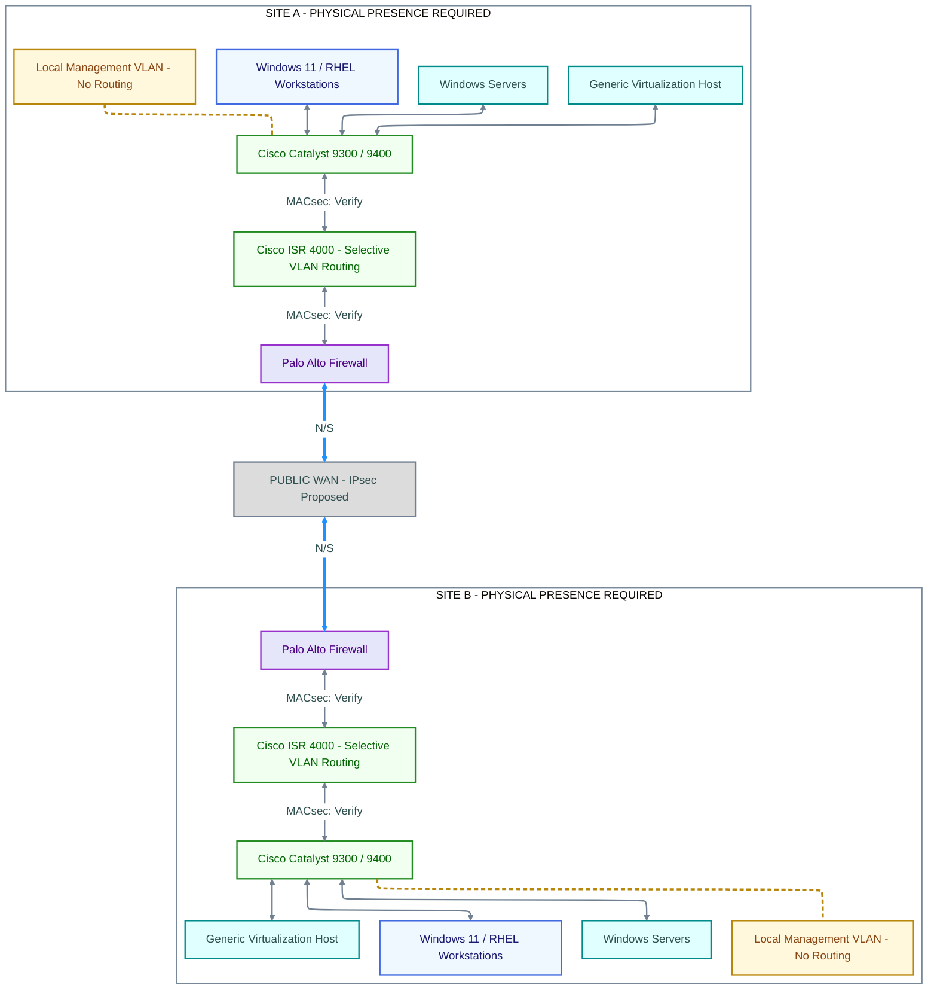

# Two-site physical topology

This preserves the handoff's required device order. Site A is above Site B. Nodes summarize equipment classes; they are not a bill of materials. Management lines represent local attachment only, not routing through the ISR.

**Legend:** Blue nodes are endpoints; green network infrastructure; teal servers and virtualization hosts; purple firewalls; amber management; gray external networks. Gray links show connectivity, blue links show north-south site-boundary traffic, and amber dashed links show local management attachment. Bidirectional arrows describe connectivity, not an allow rule. Encryption labels identify mechanisms and status.

**Interpretation:** The path is Catalyst → ISR → Palo Alto → WAN → Palo Alto → ISR → Catalyst. IPsec is proposed between Palo Alto peers; the WAN label does not claim encryption is active. All Ethernet links, including endpoint and host uplinks without individual labels, require [MACsec compatibility assessment](../procurement/hardware-compatibility.md). Ordinary firewall dataplane MACsec is unconfirmed. No link is asserted validated.

**Render review:** See [diagram verification](../standards/diagram-verification.md). ELK is the intended layout; a target Markdown viewer may differ.
