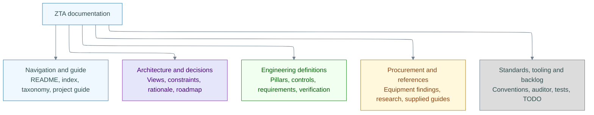

# Documentation taxonomy

Use the [complete index](index.md) to find a file, the [project guide](zta-project-guide.md) for an introduction, and this map to understand where new work belongs.

## Documentation map

**Legend:** Blue is orientation, purple is design, green is engineering definition, amber is supporting input and gray is repository maintenance. Arrows group document purposes. These are navigation categories, not network paths, authorization decisions or authoritative entity parents. See the [diagram verification record](standards/diagram-verification.md) for rendering status.

## Where new work belongs

| Document type | Location | Purpose |
|---|---|---|
| `navigation` | Root documents and the decision index | Entry points, catalog and taxonomy |
| `guide` | `zta-project-guide.md` | An introductory explanation spanning multiple areas |
| `architecture` | `architecture/` | Views, boundaries, open design inputs and roadmap |
| `decision` | `architecture/decisions/` | Stable decisions and rationale |
| `pillar` | `pillars/` | Responsibility areas and authoritative control references |
| `control` | `controls/` | One authoritative definition per control |
| `requirements` | Control-specific directories | Testable obligations decomposed from a control |
| `verification` | Control-specific directories | Test procedures; execution and evidence remain distinct |
| `procurement` | `procurement/` | Exact equipment and compatibility investigations |
| `reference` | `references/` | Standards citations and research; supplied guides are imports under `references/guides/` |
| `standard` | `standards/` | Project authoring and review conventions |
| `tooling` | `tools/README.md` | Auditor, index generator and test usage |
| `backlog` | `TODO.md` | Documentation maintenance tasks |

Imported source guides preserve their original content and are listed separately from maintained documents. They do not receive project metadata or declare project entities. Generated reports are local outputs. Neither category is evidence of deployed security controls.

## Engineering traceability

`Pillar → Control → Requirement → Test → Evidence`

This chain describes authoritative entities inside the documents. The frontmatter `parent` and `lineage` attach a document to its engineering scope. A file's `document_type` describes its purpose and does not replace that chain.

For example, `ROOT > ZT-05 > NET-04 > MAC-001 > TEST-003` connects the Network & Environment pillar to MACsec, physical port compatibility and the ISR verification test. Reviewed evidence is future work; no evidence records are currently declared. The [MACsec verification plan](controls/macsec/verification.md) contains the test definitions.

Future hardware inventories, access scenarios and evidence records should be added when their engineering inputs exist. This taxonomy does not invent controls, equipment selections or acceptance results.
