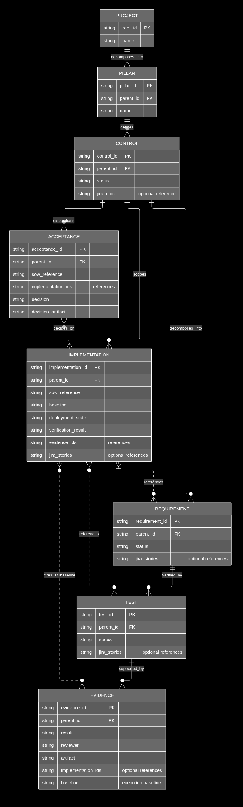

# ZTA decomposition entity relationship diagram

This diagram summarizes the traceable entity tables and their relationships. Solid connectors show the authoritative parent hierarchy. Dotted connectors show reference fields that supplement that hierarchy. The diagram describes the repository's table model; it does not claim that future evidence, implementation, or acceptance records already exist.

The Mermaid source uses native theme variables and entity classes. A [PNG render](images/zta-decomposition-erDiagram.png) is available for visual comparison.



The image is the preview artifact so the connectors remain visible when an editor scales the full diagram to fit its pane. The source below uses native Mermaid styling under the project r1.0.7 guide.

<details>
<summary>Editable Mermaid source</summary>

```mermaid
---
config:
  theme: base
  look: classic
  layout: elk
  themeVariables:
    darkMode: true
    background: black
    primaryColor: dimgray
    primaryTextColor: white
    textColor: white
    lineColor: white
    clusterBkg: black
    clusterBorder: black
    attributeBackgroundColorOdd: dimgray
    attributeBackgroundColorEven: gray
    edgeLabelBackground: black
---
%% Solid lines represent declared parentage; dotted lines represent reference fields.
erDiagram
  subgraph SG_DARK[" "]
    PROJECT ||--|{ PILLAR : decomposes_into
    PILLAR ||--o{ CONTROL : defines
    CONTROL ||--o{ REQUIREMENT : decomposes_into
    REQUIREMENT ||--o{ TEST : verified_by
    TEST ||--o{ EVIDENCE : supported_by
    CONTROL ||--o{ IMPLEMENTATION : scopes
    CONTROL ||--o{ ACCEPTANCE : dispositions
    IMPLEMENTATION }|..o{ REQUIREMENT : references
    IMPLEMENTATION }o..o{ TEST : references
    IMPLEMENTATION }o..o{ EVIDENCE : cites_at_baseline
    ACCEPTANCE }o..|{ IMPLEMENTATION : decides_on

    PROJECT {
      string root_id PK
      string name
    }
    PILLAR {
      string pillar_id PK
      string parent_id FK
      string name
    }
    CONTROL {
      string control_id PK
      string parent_id FK
      string status
      string jira_epic "optional reference"
    }
    REQUIREMENT {
      string requirement_id PK
      string parent_id FK
      string status
      string jira_stories "optional references"
    }
    TEST {
      string test_id PK
      string parent_id FK
      string status
      string jira_stories "optional references"
    }
    EVIDENCE {
      string evidence_id PK
      string parent_id FK
      string result
      string reviewer
      string artifact
      string implementation_ids "optional references"
      string baseline "execution baseline"
    }
    IMPLEMENTATION {
      string implementation_id PK
      string parent_id FK
      string sow_reference
      string baseline
      string deployment_state
      string verification_result
      string evidence_ids "references"
      string jira_stories "optional references"
    }
    ACCEPTANCE {
      string acceptance_id PK
      string parent_id FK
      string sow_reference
      string implementation_ids "references"
      string decision
      string decision_artifact
    }
  end
  classDef nodeEntity fill:dimgray,stroke:white,color:white
  class PROJECT,PILLAR,CONTROL,REQUIREMENT,TEST,EVIDENCE,IMPLEMENTATION,ACCEPTANCE nodeEntity
```
</details>

## Reading the model

- The solid hierarchy follows the declared `Parent ID` and lineage: `ROOT → Pillar → Control → Requirement → Test → Evidence`. A child row belongs to one immediate parent; a parent can have zero or more children while the project is being developed.
- Implementation and acceptance tables are also direct children of the applicable control. They do not re-parent requirements, tests, or evidence. Dotted connectors represent their typed reference fields. An implementation records scoped deployment and verification facts; acceptance records the customer's decision against a SOW and one or more implementations.
- The reference connections are many-to-many where records may cite multiple engineering items and an engineering item may be reused by multiple scoped implementations. Evidence cited by an implementation must still match that implementation's ID and exact baseline.
- `Jira epic`, `Jira stories`, and SOW references are attributes/links, not hierarchy entities. Jira work remains manually linked. Procurement research and descriptive inventories are supporting documents, not entity types in this traceability model.

The diagram shows table types, not a database deployment. The current MACsec source tables define controls, requirements, and tests; no actual Evidence, Implementation, or Acceptance rows have been declared. Their shapes and fields show the agreed record model for future work, not completed implementation, verification, or customer acceptance.

See [documentation conventions](standards/documentation-conventions.md#traceable-tables), [implementation and acceptance records](standards/implementation-acceptance.md), and the [ZTA project Mermaid standard](standards/mermaid-best-practices-zta.md).
