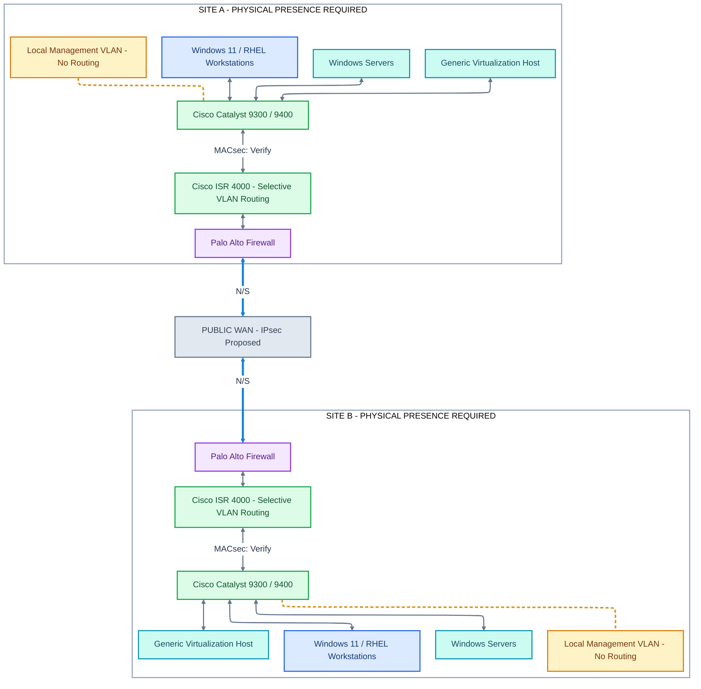

# ZTA Decomposition — Project Handoff

**Document ID:** DOC-ZTA-HANDOFF-001  
**Version:** 1.0  
**Date:** October 24, 2026  
**Project:** zta-decomposition  
**Status:** Approved conceptual direction; detailed implementation pending  
**Primary format:** Markdown with Mermaid diagrams and hierarchical tables

---

## 1. Purpose of This Handoff

This document transfers the architecture decisions, documentation methodology, technology assumptions, research findings, and future work established during the initial Zero Trust Architecture (ZTA) design discussions.

It is intended to provide sufficient context for a new ChatGPT Project or engineering team to continue the work without repeating earlier architecture discovery.

**Important:** This is a proposed reference architecture, not an as-built configuration or certification of Zero Trust compliance.

Statements in this document are categorized as:

| Status | Meaning |
|---|---|
| Required | Established architecture or security requirement |
| Proposed | Intended design that has not been finalized |
| Verify | Requires vendor, engineering, or configuration verification |
| Validated | Successfully tested and supported by documented evidence |

None of the equipment integrations should be assumed validated merely because they appear in a diagram.

## 2. Project Objectives

Develop an enterprise-grade, modular Zero Trust Architecture documentation repository based on the seven Department of Defense Zero Trust pillars.

The documentation must:

- Represent the actual proposed technologies and network layout.
- Explain what each security control protects and where enforcement occurs.
- Show north-south and east-west communications.
- Distinguish network segmentation from encryption.
- Preserve hardware and software compatibility findings.
- Support progressively detailed technical decomposition.
- Trace requirements through controls to verification tests and evidence.
- Allow different engineering groups to maintain separate Markdown documents.
- Support automated documentation integrity audits.
- Remain understandable to engineering, security, management, and assessment audiences.

The intended outcome is a maintainable, auditable architecture repository—not a single large report.

## 3. Documentation Architecture and Methodology

The documentation methodology is based on three complementary principles.

### 3.1 Functional Decomposition

**Definition:** Breaking the Zero Trust Architecture into smaller, independently understandable components.

The overall architecture is decomposed into seven pillars. Each pillar can be expanded into controls, technical requirements, implementation guidance, acceptance tests, and evidence.

Example:

Network & Environment → MACsec → Physical Port Compatibility → ISR 4000 Verification

Each document should have a clear scope and technical owner.

### 3.2 Hierarchical Traceability

**Definition:** Maintaining parent-child relationships from Zero Trust pillars through security controls, requirements, and verification evidence.

Every significant architecture element receives a stable identifier.

| Level | Example ID | Meaning |
|---|---|---|
| Pillar | ZT-05 | Network & Environment |
| Control | NET-04 | MACsec |
| Requirement | MAC-001 | Physical Port Compatibility |
| Verification | TEST-003 | ISR 4000 MACsec Test |

Every child identifies its immediate parent.

A detailed table must also reveal the complete ancestry of the element it describes.

The desired properties are:

- A table has a unique Table ID.
- Each row has a unique Row ID.
- Each row identifies its immediate parent.
- Every table identifies its parent and full ancestry.
- Parent, grandparent, and originating pillar are discoverable.
- Cross-pillar relationships are referenced rather than duplicated.
- IDs remain stable when rows or files are reorganized.

### 3.3 Documentation as Code (Docs-as-Code)

**Definition:** Maintaining Markdown architecture documentation in a version-controlled repository where engineering teams can collaborate independently.

The repository will use Markdown for narratives and tables, Mermaid for diagrams, Git for version control, relative Markdown links for navigation, and Python for automated consistency audits.

Important decisions should be recorded in Architecture Decision Records (ADRs).

### 3.4 How These Principles Work Together

| Principle | Question answered | Result |
|---|---|---|
| Functional Decomposition | How is the architecture divided? | Smaller, focused documents |
| Hierarchical Traceability | How does each component relate to the whole? | Parent-child accountability |
| Docs-as-Code | How is the architecture maintained collaboratively? | Versioned, reviewable documentation |

**Governing principle:** Every requirement should be traceable to an architectural objective, every implemented control should be verifiable, and every major design decision should have documented rationale.

## 4. Enterprise Environment

### 4.1 Sites

The architecture contains two geographically separated physical sites:

- Site A
- Site B

Both sites contain nearly identical classes of equipment and computing resources.

### 4.2 Networking Equipment

- Cisco Catalyst 9300 switches
- Cisco Catalyst 9400 switches
- Cisco ISR 4000-series routers
- Palo Alto Networks firewalls
- Multiple VLANs and security zones
- Public WAN connecting the sites

### 4.3 Computing Infrastructure

- Windows servers
- Windows 11 workstations
- Red Hat Enterprise Linux 9 workstations
- RHEL server workloads where required
- Generic virtualization hosts
- Several virtual machines per virtualization host

The virtualization technology must remain vendor-neutral. Do not assume VMware, Proxmox, Red Hat Virtualization, Hyper-V, or any specific hypervisor.

### 4.4 Identity and Security Technologies

- Active Directory
- PKI access cards
- RSA token-based authentication
- Privileged Access Management (PAM)
- Cisco Identity Services Engine (ISE)
- IEEE 802.1X
- IEEE 802.1AE MACsec
- Proposed IPsec for public WAN protection
- TLS or equivalent approved application-layer protection

The deployment locations and integration details of identity infrastructure are not yet finalized.

## 5. Established Architectural Decisions

| Decision ID | Requirement or decision | Status |
|---|---|---|
| ADR-001 | Users must be physically present at Site A or Site B to initiate authorized user authentication | Required |
| ADR-002 | No off-site remote-user authentication is exposed from the public WAN | Required |
| ADR-003 | Preserve the specified Catalyst → ISR → Palo Alto → WAN topology at each site | Required |
| ADR-004 | ISR routers handle selected authorized inter-VLAN communications | Required |
| ADR-005 | Management VLANs remain local, isolated, and non-routed | Required |
| ADR-006 | Management access requires an approved machine on a physical management switchport or a management VM with one management-connected vNIC | Required |
| ADR-007 | Virtualization remains vendor-neutral | Required |
| ADR-008 | MACsec is desired on every wired Ethernet port; incompatibilities must be identified and resolved or formally excepted | Required objective / Verify |
| ADR-009 | Protect public WAN inter-site communications with an approved mechanism; Palo Alto IPsec is the current candidate | Proposed |
| ADR-010 | Mermaid architecture diagrams use top-down layouts | Required |
| ADR-011 | Legends and interpretation guidance appear below Mermaid diagrams, not inside them | Required |
| ADR-012 | Detailed requirements use hierarchical parent-child traceability | Required |
| ADR-013 | Documentation is divided into independently maintained Markdown files | Required |

### 5.1 Important authentication distinction

Users authenticate using a PKI access card or RSA token, as appropriate to the applicable authentication workflow.

Users must be physically present at either site.

This requirement does not necessarily prohibit an authorized, physically present user at Site A from accessing protected resources at Site B.

It also does not automatically prohibit authentication-related service traffic crossing an authorized inter-site connection.

The following decisions must remain separate:

1. Network admission through 802.1X and Cisco ISE.
2. User authentication through the applicable PKI/RSA/AD integration.
3. Privileged access authorization through PAM.
4. Network resource reachability through ACLs and firewall policies.
5. Application and data authorization.

Authentication does not automatically establish authorization or permanent trust.

## 6. Primary Network Topology

The exact intended sequence is:

Site A ↔ Cisco Catalyst switch ↔ Cisco ISR router ↔ Palo Alto firewall ↔ Public WAN ↔ Palo Alto firewall ↔ Cisco ISR router ↔ Cisco Catalyst switch ↔ Site B

Site A appears at the top of diagrams and Site B at the bottom.

### 6.1 Top-down Mermaid starter diagram



**Diagram status:** Mermaid source for review. Render and visually verify before publication.

## 7. Diagram Color and Annotation Standards

### 7.1 Node colors

| Node color | Meaning |
|---|---|
| Blue | Windows/RHEL workstation or endpoint |
| Green | Network infrastructure, including switches and routers |
| Teal | Servers, virtualization hosts and workloads |
| Purple | Firewalls and security enforcement infrastructure |
| Amber | Management-only resources or networks |
| Gray | External networks, including the public WAN |

Node colors identify roles, not trust or compliance status.

### 7.2 Connection colors

| Line color/style | Meaning |
|---|---|
| Blue solid | North-south traffic crossing a defined site boundary |
| Purple solid/dashed | East-west internal communication; dashed when showing a logical session |
| Amber dashed | Local management VLAN connectivity |
| Gray solid | Physical or virtual connectivity without an asserted traffic direction |

A single physical link may carry multiple kinds of traffic.

North-south and east-west classification is relative to the boundary being evaluated.

### 7.3 Encryption annotations

Show encryption as connection labels rather than additional colors.

Examples:

- `MACsec: Verify`
- `IPsec: Proposed`
- `TLS: Verify`
- `MACsec: Validated`

MACsec is Layer 2 protection, IPsec protects applicable network communications, and TLS protects application sessions.

Encryption does not automatically imply authorization.

### 7.4 Text below every diagram

Every diagram should have a legend and a short interpretation section below it in Markdown.

The standard explanation covers:

1. Node color means component role.
2. Line color means communication type.
3. Annotations identify security mechanisms and implementation status.
4. Connectivity does not imply unrestricted authorization.

Do not embed lengthy legends or numbered instructions inside Mermaid.

## 8. Management Network Requirements

The management network is intentionally isolated and operates locally at each physical site.

### 8.1 Permitted ways to attach

A management endpoint must be either:

1. An approved machine physically connected to a Cisco switchport assigned to the management VLAN.
2. An approved management VM with exactly one virtual NIC attached to the management network.

### 8.2 Prohibited connectivity

- No normal routed connectivity from production VLANs.
- No management VLAN route through the ISR to other VLANs.
- No WAN route to the management VLAN.
- No management VLAN extension between Site A and Site B.
- No unauthorized VM routing, NAT, forwarding or bridging into management.
- No secondary management VM network interface that bypasses the restriction.

The host's virtual-switch configuration, permissions and management plane must prevent bypassing these restrictions.

### 8.3 Virtualization design

Each site includes a generic virtualization host with several example VMs:

| VM | Role | Network |
|---|---|---|
| VM-01 | Windows Server | Approved production VLAN |
| VM-02 | RHEL Server | Approved production VLAN |
| VM-03 | Management workstation | One management-network vNIC only |

The hypervisor product and vendor must remain unspecified until selected.

A one-vNIC management VM does not, by itself, prove complete isolation. Host-level bridging, virtual-switch permissions and network attachment controls must be validated.

## 9. Seven-Pillar Zero Trust Architecture

The DoD seven-pillar framework is the primary organization scheme. NIST SP 800-207 provides complementary principles for resource-oriented authorization and policy enforcement.

### 9.1 High-level pillar matrix

<!-- zta-table: id=TBL-ZT-PILLARS; parent=ROOT; lineage=ROOT -->

| Parent ID | Pillar ID | Pillar | Primary technologies | Responsibility |
|---|---|---|---|---|
| ROOT | ZT-01 | User | AD, PKI, RSA, PAM | User authentication and privileged access |
| ROOT | ZT-02 | Device | Cisco ISE, 802.1X, Catalyst | Network admission and endpoint trust signals |
| ROOT | ZT-03 | Application & Workload | Windows, RHEL, VMs | Resource and workload authorization |
| ROOT | ZT-04 | Data | AD permissions, databases, encryption | Protect data access and confidentiality |
| ROOT | ZT-05 | Network & Environment | Catalyst, ISR, Palo Alto, MACsec, IPsec | Segmentation and protected transport |
| ROOT | ZT-06 | Automation & Orchestration | ISE CoA, PAM workflows, potential integrations | Risk-driven response |
| ROOT | ZT-07 | Visibility & Analytics | Identity, endpoint and network logs | Detection, investigation and audit |

Not all listed functionality has been confirmed as deployed. For example, centralized SIEM, endpoint detection tooling and automation integrations have not yet been specified.

### 9.2 Example pillar decomposition

The Network & Environment pillar illustrates the expected parent-child format.

**Parent:** ZT-05 — Network & Environment

<!-- zta-table: id=TBL-ZT05-CONTROLS; parent=ZT-05; lineage=ROOT>ZT-05 -->

| Parent ID | Control ID | Technology | Function |
|---|---|---|---|
| ZT-05 | NET-01 | Catalyst / ISE | Network admission and VLAN policies |
| ZT-05 | NET-02 | ISR 4000 | Selective inter-VLAN routing |
| ZT-05 | NET-03 | Palo Alto | Inter-site security enforcement |
| ZT-05 | NET-04 | MACsec | Ethernet link protection |
| ZT-05 | NET-05 | IPsec | WAN transport protection |
| ZT-05 | NET-06 | Management VLAN | Local-only management isolation |

### 9.3 MACsec requirement decomposition

**Parent:** NET-04 — MACsec  
**Grandparent:** ZT-05 — Network & Environment

<!-- zta-table: id=TBL-MAC-REQUIREMENTS; parent=NET-04; lineage=ROOT>ZT-05>NET-04 -->

| Parent ID | Requirement ID | Requirement | Verification |
|---|---|---|---|
| NET-04 | MAC-001 | Identify MACsec-capable ports | Vendor hardware matrix |
| NET-04 | MAC-002 | Verify supported cipher suites | Documentation and configuration |
| NET-04 | MAC-003 | Validate MKA interoperability | Peer testing |
| NET-04 | MAC-004 | Reject unintended plaintext fallback | Negative testing |
| NET-04 | MAC-005 | Meet required link throughput | Performance testing |
| NET-04 | MAC-006 | Provide useful operational telemetry | Session and event inspection |

Detailed equipment-specific verification tables should use the same pattern, with `MAC-001` as their parent.

### 9.4 Cross-pillar relationships

A security control may support multiple pillars.

For example, Cisco ISE contributes to Device and Network & Environment capabilities.

To avoid conflicting definitions:

- Assign a control one authoritative primary parent.
- Maintain the detailed definition in one location.
- Use related-control references from other pillars.
- Do not create independent conflicting versions of the same requirement.

## 10. Seven-Pillar Control Overlay

The existing logical control overlay was accepted as a useful architecture view.

It must show the following relationships without redrawing the complete two-site physical topology.

| Pillar | Primary control relationship |
|---|---|
| User | AD/PKI/RSA authenticates the user; PAM mediates privileged requests |
| Device | Cisco ISE evaluates applicable 802.1X/RADIUS admission and authorization |
| Application & Workload | Windows, RHEL and applications enforce resource permissions |
| Data | File/database permissions and encryption protect information |
| Network & Environment | Catalyst, ISR and Palo Alto enforce their respective network policies |
| Automation & Orchestration | Proposed integrations can trigger quarantine, blocking or revocation |
| Visibility & Analytics | Identity, device, network, PAM and workload telemetry supports detection and investigation |

Re-use these established identifiers across diagrams:

| Component ID | Meaning |
|---|---|
| SITE_A_CLIENTS_01 | Site A endpoint group |
| SITE_B_CLIENTS_01 | Site B endpoint group |
| SITE_A_SW_01 | Site A Catalyst switch |
| SITE_B_SW_01 | Site B Catalyst switch |
| SITE_A_RTR_01 | Site A ISR router |
| SITE_B_RTR_01 | Site B ISR router |
| SITE_A_FW_01 | Site A Palo Alto firewall |
| SITE_B_FW_01 | Site B Palo Alto firewall |
| SITE_A_SERVERS_01 | Site A servers |
| SITE_B_SERVERS_01 | Site B servers |
| SITE_A_VM_HOST_01 | Site A virtualization host |
| SITE_B_VM_HOST_01 | Site B virtualization host |
| SITE_A_MGMT_01 | Site A management VLAN |
| SITE_B_MGMT_01 | Site B management VLAN |
| CTRL_USER_AUTH | AD/PKI/RSA user authentication |
| CTRL_ISE | Cisco ISE network authorization |
| CTRL_PAM | Privileged access control |
| CTRL_APP_AUTH | Application/workload authorization |
| CTRL_DATA_AUTH | Data access authorization |
| CTRL_TELEMETRY | Monitoring and security telemetry |
| CTRL_RESPONSE | Proposed automation and response |

The overlay must clearly separate network admission, user authentication, privileged elevation, routed reachability, application authorization and data authorization.

Logical relationships should not be mistaken for direct physical cables.

## 11. MACsec Architecture and Procurement

### 11.1 Design objective

MACsec protection is desired on all wired Ethernet ports.

The procurement process must establish exactly which interfaces and peer combinations can meet this objective.

Incompatible interfaces must not be silently described as MACsec-protected.

Possible outcomes include:

- Selecting alternative MACsec-capable hardware.
- Choosing different interface modules or line cards.
- Modifying the architecture.
- Documenting and approving explicit exceptions and compensating controls.

### 11.2 Important vendor research findings

| Vendor/product | Finding | Design consequence |
|---|---|---|
| Catalyst 9300 | C9300-48UXM and C9300-48UN support MACsec on their first 16 downlinks and applicable uplink-module ports, not the remaining 32 downlinks | Require model-specific port inventories |
| Catalyst 9400 | Support varies with supervisor and line-card combinations; C9400-SUP-1XL-Y supervisor ports do not support MACsec | Verify every selected module/port |
| Cisco ISR 4000 | Cisco identifies the NIM-2GE-CU-SFP as MACsec-capable; built-in front-panel GE ports are not listed as MACsec-capable in the referenced module comparison | Validate modules and licensing |
| Windows 11 | Cisco Secure Client Network Access Manager documents Windows IEEE 802.1AE support | Validate endpoint software and NIC performance |
| RHEL 9 | Red Hat documents Linux MACsec configuration | Validate interoperable MKA and throughput |
| Palo Alto | Documented MACsec support exists for specific HSCI NGFW cluster links | Do not assume ordinary firewall dataplane ports support MACsec |

These are vendor-document findings, not proof that a particular proposed installation is compatible.

### 11.3 Procurement questionnaire categories

Require vendors to answer the following for exact hardware models, software releases and licensing:

**Hardware and ports:** Which exact SKUs, interfaces, modules, link speeds and media support MACsec? Are there partial-port restrictions or dependencies on ASICs or NICs?

**Encryption:** Which AES-GCM cipher suites, XPN options, replay protections and confidentiality settings are supported?

**Authentication and key management:** What MKA, EAP-TLS, certificate, pre-shared key and lifecycle options are supported?

**Interoperability:** Can the exact endpoints establish compatible MACsec sessions? Are VLAN trunks, link aggregation and chosen interfaces supported?

**Licensing:** What OS release and software licenses are required?

**Operational behavior:** What happens when MKA negotiation fails, a peer reboots, keys rotate, or a link fails? Can mandatory encryption fail closed?

**Performance:** What throughput, MTU impact, CPU consumption and hardware acceleration characteristics apply?

**Monitoring:** What CLI/API commands, logs and counters prove that MACsec is active?

**Endpoint support:** Are Windows 11, RHEL 9, and generic virtualization-host uplinks compatible with the intended MACsec design?

**Acceptance:** Can the vendor demonstrate a proof of concept with the exact equipment and configuration before procurement approval?

### 11.4 Key technical distinction

802.1X determines network admission.

MACsec protects compatible Ethernet links.

ISR ACLs, Palo Alto security rules, and host/application controls determine access according to their applicable policies.

IPsec is proposed for the public WAN, and TLS should be evaluated for application traffic.

These are complementary controls, not interchangeable protections.

## 12. Proposed Documentation Repository

The intended repository layout is:

```text
zta-decomposition/
├── README.md
├── architecture/
│   ├── overview.md
│   ├── physical-topology.md
│   ├── logical-topology.md
│   ├── seven-pillar-control-overlay.md
│   └── decisions/
│       └── README.md
├── pillars/
│   ├── ZT-01-user.md
│   ├── ZT-02-device.md
│   ├── ZT-03-application-workload.md
│   ├── ZT-04-data.md
│   ├── ZT-05-network-environment.md
│   ├── ZT-06-automation-orchestration.md
│   └── ZT-07-visibility-analytics.md
├── controls/
│   ├── macsec/
│   │   ├── overview.md
│   │   ├── requirements.md
│   │   └── verification.md
│   ├── network-segmentation/
│   ├── identity-authentication/
│   └── management-isolation/
├── procurement/
│   ├── macsec-equipment-assessment.md
│   └── hardware-compatibility.md
├── references/
│   ├── vendor-research.md
│   └── standards.md
├── standards/
│   ├── documentation-conventions.md
│   └── mermaid-best-practices-r1.0.5.md
└── tools/
    └── audit_zta.py
```

The main README is the entry point and contains a project overview, methodology, seven-pillar summary, high-level diagrams, architectural constraints, and navigation links.

Each pillar document is maintained independently.

Detailed technical documents should be split according to responsibility and subject matter, not merely by file size.

## 13. Documentation Ownership

Proposed ownership model:

| Engineering group | Main responsibility |
|---|---|
| Identity/IAM | ZT-01: User |
| Endpoint Engineering | ZT-02: Device |
| Systems/Virtualization | ZT-03: Application & Workload |
| Data Security | ZT-04: Data |
| Network Engineering | ZT-05: Network & Environment |
| Security Engineering | ZT-06: Automation & Orchestration |
| SOC/Detection Engineering | ZT-07: Visibility & Analytics |

Cross-team controls should have a clearly identified authoritative owner and supporting reviewers.

Changes should be maintained through version control and reviewed before integration.

## 14. Mermaid Authoring Standards

The uploaded guide `mermaid-best-practices-r1.0.5.md` is the authoritative Mermaid authoring standard for this project.

Its important conventions include:

- YAML configuration at the very top of every Mermaid diagram.
- `theme: base` and `layout: elk` by default.
- Explicit, quoted hexadecimal theme colors.
- Top-down architecture diagrams using `flowchart TB`.
- Stable uppercase underscore-separated node IDs.
- `SG_` prefixes for subgraphs.
- Meaningful `edge_` identifiers for explicitly styled edges.
- Semantic class names such as `nodeNetwork` and `edgeManagement`.
- Separate `classDef` declarations and `class` assignments.
- Two-space indentation.
- No statement semicolons.
- No inline `:::` class assignments in new diagrams.
- No bare `%%` comment lines.
- Mermaid diagrams should remain self-contained.
- Use legends in Markdown below the drawings.
- Confirm subgraph containment, labels, arrows, color contrast and styling by rendering.

Use Mermaid CLI (`mmdc`) to render each edited diagram to SVG and PNG and visually inspect it when the environment permits.

Where rendering is unavailable, report the diagram as source-reviewed but unrendered.

The guide's ELK/GitHub renderer compatibility note should also be considered if GitHub Markdown rendering is a target.

## 15. Hierarchical Table Conventions

Every detailed Markdown table should be independently identifiable.

Use a small HTML metadata comment immediately above each traceable table:

```markdown
<!-- zta-table: id=TBL-MAC-REQ; parent=NET-04; lineage=ROOT>ZT-05>NET-04 -->

| Parent ID | Requirement ID | Requirement | Verification |
|---|---|---|---|
| NET-04 | MAC-001 | Verify port support | Vendor compatibility review |
```

A table should identify its parent, grandparent and originating pillar.

Every row receives its own stable ID.

Cross-file relative links should connect to the authoritative parent documentation.

Do not use table row numbers as persistent identifiers.

Include concise ancestry breadcrumbs above detailed tables when helpful.

### 15.1 Hierarchy rule

Pillar → Control → Requirement → Test → Evidence

Not every requirement requires a separate file. Decompose further when the additional detail serves a meaningful engineering or review purpose.

### 15.2 Example ancestry

`ROOT > ZT-05 > NET-04 > MAC-001 > TEST-003`

This describes:

Zero Trust Architecture → Network & Environment → MACsec → Physical Port Compatibility → ISR MACsec Verification

## 16. Python Documentation Auditor

A reusable Python audit tool is part of the intended project design.

The initial concept was a standard-library script that checks table metadata and ancestry in a single Markdown file.

The repository version should operate recursively across Markdown documents.

Proposed command interface:

```bash
python3 tools/audit_zta.py --root . --report audit-report.md
```

This interface is proposed; the repository-wide implementation has not yet been created or tested.

### 16.1 Required checks

- Duplicate document IDs
- Duplicate table IDs
- Duplicate requirement/control/test IDs
- Missing parent IDs
- Incorrect grandparent or lineage declarations
- Circular ancestry
- Orphaned tables
- Missing promised decomposition documents
- Broken relative Markdown links
- Inconsistent document/table metadata
- Missing evidence for requirements explicitly marked Validated
- Missing or inconsistent architecture references

The script should report errors with file paths and line numbers.

It should return a nonzero exit code when critical integrity checks fail, so it can be used in automated repository workflows.

The auditor verifies documentation consistency; it does not certify technical security configuration.

## 17. Architecture Decision Records

The repository should maintain separate ADRs for material design decisions.

At minimum, preserve decisions about:

- Physical-site-only user authentication.
- No public-WAN remote-user access.
- Exact Cisco/Palo Alto topology.
- Selective inter-VLAN routing.
- Local-only management VLAN access.
- Single-vNIC management VMs.
- Vendor-neutral virtualization.
- MACsec coverage requirements and exceptions.
- Site-to-site encryption design.
- Documentation hierarchy and ownership.

Each ADR should include a stable ID, decision, rationale, status, consequences, and alternatives considered.

## 18. External Research and References

The following manufacturer and standards sources support the research findings recorded during the design discussions. They are references, not substitutes for verifying the final bill of materials.

### Standards and Zero Trust

**REF-001 — DoD Zero Trust Reference Architecture, Version 2.0**  
https://dodcio.defense.gov/Portals/0/Documents/Library/%28U%29ZT_RA_v2.0%28U%29_Sep22.pdf

**REF-002 — DoD Zero Trust Capability Execution Roadmap**  
https://dodcio.defense.gov/Portals/0/Documents/Library/ZTCapabilityExecutionRoadmap.pdf

**REF-003 — NIST SP 800-207, Zero Trust Architecture**  
https://doi.org/10.6028/NIST.SP.800-207

### Cisco

**REF-004 — Catalyst 9300 MACsec Configuration Guide, IOS XE 26.x**  
Includes restrictions for C9300-48UXM/C9300-48UN, EtherChannel member interfaces, cipher suites, and licensing.  
https://www.cisco.com/c/en/us/td/docs/switches/lan/catalyst9300/software/release/26-x/configuration_guide/sec/b_26x_sec_9300_cg/macsec_encryption.html

**REF-005 — Catalyst 9400 MACsec Configuration Guide, IOS XE 17.17.x**  
Includes supervisor and line-card limitations.  
https://www.cisco.com/c/en/us/td/docs/switches/lan/catalyst9400/software/release/17-17/configuration_guide/sec/b_1717_sec_9400_cg/macsec_encryption.html

**REF-006 — Cisco ISR 4000 Ethernet WAN Modules Data Sheet**  
Documents the MACsec module comparison.  
https://www.cisco.com/c/en/us/products/collateral/routers/4000-series-integrated-services-routers-isr/datasheet-c78-730527.html

**REF-007 — Cisco ISR 4000 Family Data Sheet**  
Discusses ISR MACsec using the NIM-2GE-CU-SFP.  
https://www.cisco.com/c/en/us/products/collateral/routers/4000-series-integrated-services-routers-isr/data_sheet-c78-732542.html

**REF-008 — Cisco Secure Client 5.x Feature and Operating-System Matrix**  
Documents Windows support for MACsec in Network Access Manager.  
https://www.cisco.com/c/en/us/td/docs/security/vpn_client/anyconnect/Cisco-Secure-Client-5/feature/guide/cisco-secure-client-features-licenses-and-oss-release-5.html

### Red Hat

**REF-009 — RHEL 9 Configuring and Managing Networking**  
Includes MACsec configuration using NetworkManager/nmcli.  
https://docs.redhat.com/en/documentation/red_hat_enterprise_linux/9/html-single/configuring_and_managing_networking/index

### Palo Alto Networks

**REF-010 — Palo Alto Networks NGFW Clusters**  
Documents MACsec on supported HSCI cluster interfaces beginning with PAN-OS 11.1.5. Does not establish ordinary firewall dataplane MACsec capability.  
https://docs.paloaltonetworks.com/ngfw/administration/ngfw-clustering/ngfw-clusters

### Project authoring reference

**REF-011 — Mermaid Best Practices Guide r1.0.5**  
User-supplied project authoring document. Upload the original file separately into the destination ChatGPT Project.

### Reference maintenance requirements

For new vendor findings, record the publication title, source URL, applicable hardware/software versions, finding, architectural impact, review date and status.

Maintain external research in `references/vendor-research.md` rather than scattering unsupported claims throughout the repository.

## 19. Open Engineering Questions

The following details require additional specification.

| Item | Outstanding question |
|---|---|
| Catalyst hardware | Exact 9300/9400 SKUs, uplinks, line cards and IOS XE releases? |
| ISR routers | Exact ISR 4000 models, interfaces, modules and licenses? |
| Palo Alto | Exact models, interfaces, PAN-OS versions and tunnel configuration? |
| MACsec | Which physical ports and endpoint combinations can support mandatory encryption? |
| Windows 11 | Which MACsec supplicant/NIC model and deployment approach? |
| RHEL 9 | Which MACsec implementation, hardware acceleration and interoperability model? |
| Virtualization | How are host uplinks, management VMs and virtual networks isolated? |
| VLANs | What is the actual list of VLANs and allowed inter-VLAN communication matrix? |
| Identity services | Where are AD, PKI, RSA, ISE and PAM hosted and how are they integrated? |
| Telemetry | Which log collection and SIEM tools are available? |
| Automation | Which response integrations are implemented or proposed? |
| Data protection | What classification, auditing and encryption requirements apply? |
| Encryption | What cipher suites, key management and compliance requirements are mandated? |

These unknowns should not be filled in by assumption.

## 20. Recommended Next Work

### Phase 1 — Establish the documentation repository

Create the directory structure, README, pillar documents, authoring conventions and ADR index.

Move the material from this handoff into the authoritative documents.

### Phase 2 — Establish controls and traceability

Create the seven-pillar matrix and the first round of decomposed control tables.

Use Network & Environment and MACsec as the initial model because they already have detailed requirements and vendor research.

### Phase 3 — Finalize architecture drawings

Maintain three primary architecture views:

1. Two-site physical network topology.
2. Site-local VLAN, management and virtualization architecture.
3. Seven-pillar logical security control overlay.

All use top-down Mermaid where practical, with legends below the drawings.

### Phase 4 — Implement the repository auditor

Extend the prototype Python concept into a recursive repository-wide audit tool.

Test it with valid and intentionally broken parent-child relationships, missing files and duplicate identifiers.

### Phase 5 — Equipment and implementation validation

Obtain exact bill-of-materials details and vendor MACsec compatibility statements.

Develop the VLAN policy matrix, identity flow details, firewall policy design and virtualization isolation requirements.

### Phase 6 — Acceptance and evidence

Produce requirements-to-test matrices.

Record actual configurations, test results, exceptions and supporting evidence.

Mark controls Validated only after review of suitable evidence.

## 21. Instructions for Continuing in a New ChatGPT Project

Use this document as project context and preserve the established decisions unless the user explicitly changes them.

When continuing:

- Do not redesign the basic Site A–WAN–Site B topology.
- Do not introduce external remote-user authentication.
- Do not route or stretch the management VLAN.
- Do not choose a virtualization vendor without user direction.
- Do not assume MACsec is available on all ports.
- Do not describe unverified equipment capabilities as validated.
- Prefer Markdown tables for detailed decomposition and requirements.
- Use Mermaid primarily for topology, control relationships and communication paths.
- Keep legends outside Mermaid.
- Use the uploaded Mermaid guide's naming and rendering conventions.
- Preserve stable IDs and full ancestry across documents.
- Preserve external references and product-specific limitations.
- Keep authoritative control definitions separate from cross-pillar references.
- Support collaboration between engineering groups through modular documents.

**Suggested first task in the destination project:**

> Using the uploaded ZTA Decomposition Project Handoff and Mermaid Best Practices Guide, scaffold the modular Markdown repository. Create the main README, seven pillar documents, documentation conventions, architecture decision index, and initial MACsec control documents. Preserve existing architecture decisions, parent-child identifiers, and vendor research. Do not assume that proposed security controls are deployed or validated.

---

## 22. Handoff Completion Criteria

The handoff is sufficient when the new project understands:

- The intended two-site architecture.
- The physical-site authentication restriction.
- The Cisco, Palo Alto, Windows, RHEL and virtualization components.
- The management VLAN isolation policy.
- The MACsec objective and known compatibility concerns.
- The seven Zero Trust pillars.
- The diagrams and their conventions.
- The functional decomposition methodology.
- The hierarchical traceability model.
- The Docs-as-Code repository structure.
- The planned Python audit capability.
- The distinction between required, proposed, verify and validated.
- The open questions that must be resolved during detailed engineering.

**End of Handoff — DOC-ZTA-HANDOFF-001**