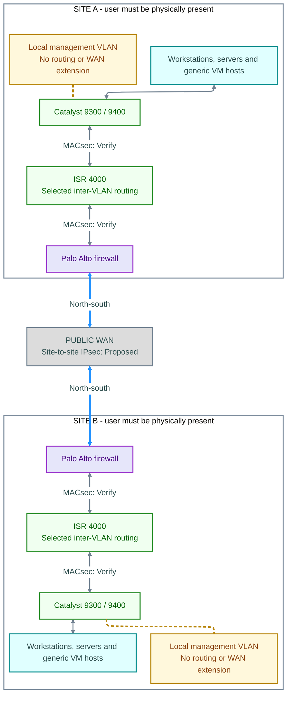
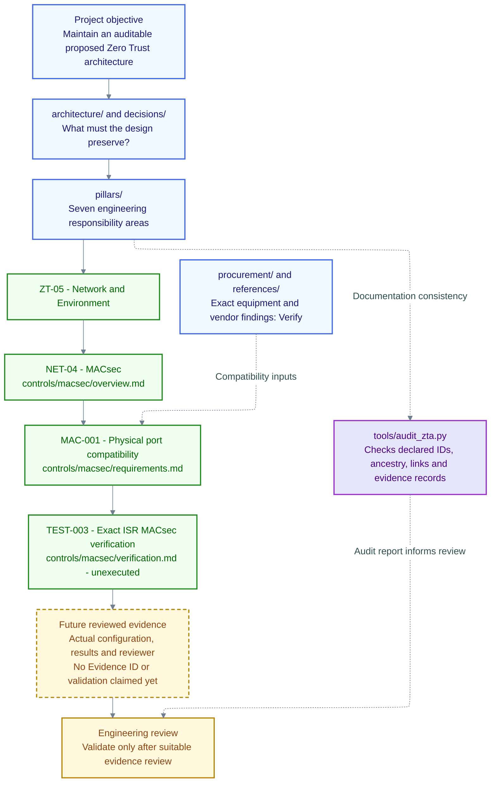

# ZTA Project Guide — Layout, Flow and Engineering Traceability

**Audience:** Junior engineers through chief engineers

This guide explains the architecture and engineering relationships. For the practical delivery workflow and adoption agreements, use [How to use this project](HOW-TO-USE.md).
## The project in one minute

We are documenting how two physical sites should protect users, devices, applications, data and communications using the seven DoD Zero Trust pillars. The deliverable is a set of linked engineering documents with stable identifiers and evidence, maintained as code. The work is currently a design scaffold, not a deployed system or compliance certification.

Read the first diagram as the network layout. Read the second as the engineering workflow: an architectural objective becomes a control, a testable requirement and eventually reviewed evidence. That distinction lets a new engineer find the next task and lets the chief engineer assess what remains unproven.

**Diagram verification:** Both embedded diagrams were rendered to SVG and PNG with Mermaid CLI 12.0.0 and visually reviewed on October 25, 2026 after execution from a normal terminal. The network view has a WAN edge crossing the Site B heading; refine that crossing before publication. The intended presentation viewer has not been tested.

## 1. Where traffic goes

**Legend:** Teal nodes summarize compute resources; green nodes are network equipment; purple nodes are firewalls; amber nodes are management networks; gray is the public WAN. Gray lines show connectivity, blue lines show site-boundary north-south traffic, and dashed amber lines show local management attachment. Bidirectional arrows indicate connectivity. Encryption labels state mechanism and verification status; colors do not indicate trust.

**Interpretation:** The required path is Site A → Catalyst → ISR → Palo Alto → public WAN → Palo Alto → ISR → Catalyst → Site B, with return traffic subject to policy. Users must be physically present at one site to initiate authorized authentication. Off-site remote-user authentication is not exposed from the public WAN. An authorized on-site user may still be permitted to reach resources at the other site.

Within a site, selected inter-VLAN traffic goes through the ISR. Same-VLAN and same-host VM traffic may stay local and avoid both the ISR and the Palo Alto. These east-west paths need enforcement at the controls actually on their path. The drawing does not grant unrestricted access.

Each management VLAN remains local, non-routed and separate from production and the WAN. Only approved physical management attachments or an approved management VM with exactly one management vNIC are permitted. Host forwarding, bridging, virtual-switch permissions and the management plane must prevent bypass. Virtualization remains vendor-neutral.

MACsec is a protection to implement where supported and operationally appropriate, including compute links without individual diagram labels. Under [ADR-014](architecture/decisions/ADR-014.md), record exact port/peer capability, functionality and workflow impacts, limitations and customer disposition. The earlier every-port objective remains historical; no coverage percentage determines acceptance. Palo Alto site-to-site IPsec is a proposed WAN mechanism. MACsec is link protection; it does not substitute for user, application or data authorization.

## 2. How the repository turns design into evidence

**Legend:** Blue nodes describe architecture documents or research inputs; green nodes show the MACsec traceability example; amber nodes describe evidence and engineering review; purple is the auditor. Solid arrows show progression or parent-child decomposition; dotted arrows show supporting inputs. The dashed evidence border means future work. These are document relationships, not network cables or authentication sessions.

**Interpretation:** `ROOT > ZT-05 > NET-04 > MAC-001 > TEST-003` is a real ancestry path in this repository. It means project → Network & Environment → MACsec → physical port compatibility → ISR verification. The next step is to select exact equipment, execute an approved procedure and record reviewed evidence. No evidence record exists yet. A passing documentation audit cannot establish that a link encrypts traffic.

## 3. Where each engineering concern belongs

| Pillar | Main concern | Proposed owner |
|---|---|---|
| ZT-01 User | AD, PKI/RSA authentication and privileged access | Identity/IAM |
| ZT-02 Device | Admission and endpoint trust signals | Endpoint Engineering |
| ZT-03 Application & Workload | Resource permissions and workload authorization | Systems/Virtualization |
| ZT-04 Data | Data permissions, classification and confidentiality | Data Security |
| ZT-05 Network & Environment | Admission, segmentation, management isolation and transport protection | Network Engineering |
| ZT-06 Automation & Orchestration | Reviewed response and revocation workflows | Security Engineering |
| ZT-07 Visibility & Analytics | Collection, detection, investigation and evidence | SOC/Detection Engineering |

A control has one authoritative parent even when it supports several pillars. For example, ISE network admission is defined under ZT-05 as NET-01 and referenced by Device and User documentation. Keep admission, user authentication, PAM elevation, network reachability, application permissions and data permissions as separate decisions.

## 4. A MACsec task a junior engineer can follow

Suppose the assigned link is the Catalyst-to-ISR Ethernet link at Site A. Start with MAC-001 and TEST-003, then identify the exact models, modules, ports, media, software releases and licenses on both ends. The equipment-family name alone is insufficient.

The imported vendor research identifies the ISR NIM-2GE-CU-SFP as a MACsec-capable candidate; it does not validate the selected router, built-in port or actual peer combination. Catalyst support also varies by model and port. Record the applicable vendor source, version and finding before making a compatibility claim.

Once engineering approves the selected peers and protection profile, execute the verification procedure, capture actual configuration and protected-session counters, record failures and attach reviewed artifacts under the test. Cipher agreement, MKA behavior, rejection of unintended plaintext fallback, throughput and telemetry also have separate MACsec requirements. A successful port-capability check alone does not satisfy the whole control.

If a link cannot meet the objective, record the limitation, operational impact, residual risk and alternatives or compensating controls in the [implementation register](implementation/macsec.md). Record the customer disposition in the [acceptance register](acceptance/macsec.md). The customer can accept a documented limitation while technical verification remains Not executed or Failed. Never fill an evidence field with an assumed result.

## 5. How to navigate and review

| Location | What it answers |
|---|---|
| `README.md` | Where do I start and what are the constraints? |
| `architecture/` and `architecture/decisions/` | What is the design and why must it stay this way? |
| `pillars/` | Which engineering group owns the concern? |
| `controls/` | What control, requirement and verification procedure applies? |
| `procurement/` and `references/` | What equipment and source material support the design? |
| `standards/` | How are documents, IDs, tables and diagrams maintained? |
| `tools/` and `tests/` | How is declared documentation consistency checked? |

Use `Required` for an established objective, `Proposed` for an unfinished design, `Verify` for an unconfirmed capability and `Validated` only for a claim supported by reviewed evidence. Ownership assignments are proposals until accepted. Exact hardware, VLAN policies, identity service locations, approved cipher profiles, SIEM and response integrations remain open engineering inputs.

A chief engineer can review any claim by asking: What is its parent objective? Who owns it? Where is enforcement on the actual path? Which test covers it? What evidence exists? Which exceptions or dependencies remain unresolved?

This guide contains the context needed for an introductory review without opening other files. For implementation work, use the authoritative definitions in the repository; this guide summarizes them.
